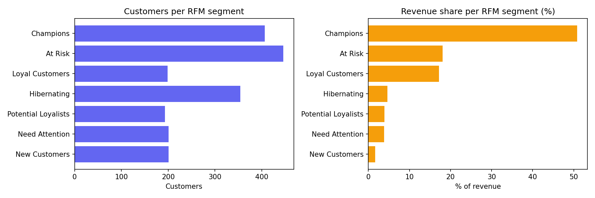
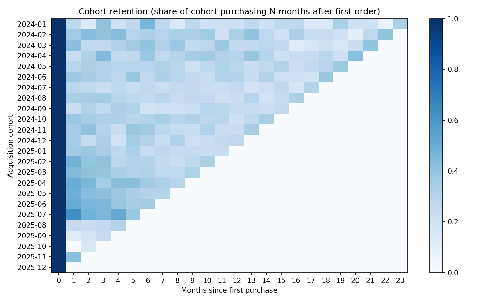
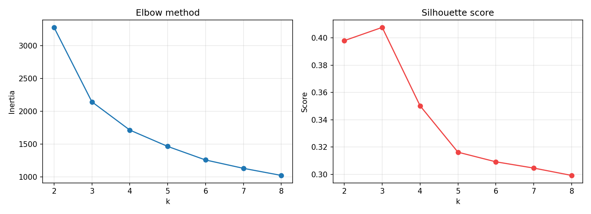

# 🛒 Customer Behaviour Analysis

End-to-end customer analytics for an e-commerce business: **RFM segmentation, K-Means clustering, cohort retention and customer lifetime value (CLV)**, with an interactive Streamlit dashboard.

> **Business question:** Who are our most valuable customers, who is about to leave, and where should marketing spend go?

## Highlights

- Cleans raw transaction data (drops returns / invalid rows) and builds **Recency, Frequency, Monetary** features per customer
- Rule-based **RFM segments** (Champions, Loyal, At Risk, Hibernating, ...) using 1–5 quintile scores
- **K-Means** clustering on log-scaled, standardised RFM with elbow + silhouette analysis to choose *k*
- **Monthly cohort retention** heatmap
- **Segment-level CLV** = average order value × orders per year × lifespan × margin
- **Streamlit dashboard** with CSV upload, tunable parameters and downloadable segment lists
- Unit tests (`pytest`) covering cleaning, RFM maths, clustering, cohorts and CLV

## Project structure

```
customer-behaviour-analysis/
├── app.py                    # Streamlit dashboard
├── src/
│   ├── generate_data.py      # synthetic transaction generator
│   ├── rfm.py                # cleaning, RFM features, segments
│   ├── segmentation.py       # K-Means + cluster profiling
│   ├── cohort.py             # cohort retention + CLV
│   └── analysis.py           # full pipeline -> reports/ & figures
├── tests/test_rfm.py
├── data/                     # transactions.csv is generated here (git-ignored)
├── reports/                  # CSV outputs + figures
└── requirements.txt
```

## Quick start

```bash
git clone https://github.com/<your-username>/customer-behaviour-analysis.git
cd customer-behaviour-analysis
python -m venv .venv && source .venv/bin/activate      # Windows: .venv\Scripts\activate
pip install -r requirements.txt

python -m src.generate_data      # creates data/transactions.csv (2,000 customers, ~30k rows)
python -m src.analysis           # runs the pipeline, writes reports/ and reports/figures/
streamlit run app.py             # launches the dashboard
pytest                           # runs the tests
```

## Using your own data

Any CSV with these columns works (e.g. the UCI *Online Retail II* dataset after renaming columns):

| column | description |
|---|---|
| `invoice_id` | order identifier |
| `customer_id` | customer identifier |
| `invoice_date` | order date |
| `quantity`, `unit_price` | line item quantity and price |
| `category` *(optional)* | enables the category revenue chart |

```bash
python -m src.analysis --data path/to/your_file.csv --k 5
```

## Results (on the bundled synthetic dataset, seed 42)

| Metric | Value |
|---|---|
| Customers / orders | 2,000 / 12,076 |
| Revenue concentration | **Top 20% of customers generate ~61% of revenue** |
| Champions | 20% of customers → **~51% of revenue** |
| At Risk | 22% of customers, ~18% of revenue, avg. 215 days since last order |
| Best *k* by silhouette | 3 (k=4 used for a richer business story) |

Segment CLV (25% margin, 3-year horizon): Champions ≈ 1,419 vs Hibernating ≈ 149 — roughly **10×** higher.

Figures are written to `reports/figures/` (monthly revenue, category revenue, RFM segments, k-selection, clusters, cohort retention).

> ⚠️ The numbers above come from a *synthetic* dataset created by `src/generate_data.py`, so they demonstrate the method, not real-world findings. Plug in real data to get real insights.

## Recommended actions (how the analysis would be used)

| Segment | Action |
|---|---|
| Champions | Loyalty perks, early access, referral programme |
| Loyal Customers | Upsell / cross-sell, premium tiers |
| At Risk | Win-back offers, personalised reminders (high CLV, rising recency) |
| Potential Loyalists / New | Onboarding series, second-purchase incentive |
| Hibernating | Low-cost reactivation campaign or suppress from paid ads |

## Visuals





## Tech stack

Python · pandas · NumPy · scikit-learn · Matplotlib · Streamlit · pytest

## Possible extensions

- Churn prediction model using RFM features as inputs
- Market-basket analysis (Apriori) for cross-sell rules
- Time-series forecasting of revenue per segment
- Deploy dashboard on Streamlit Community Cloud

## License

MIT
