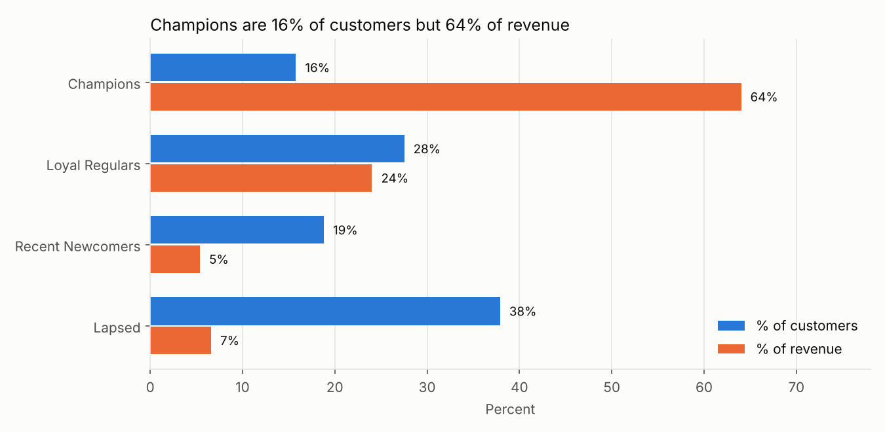
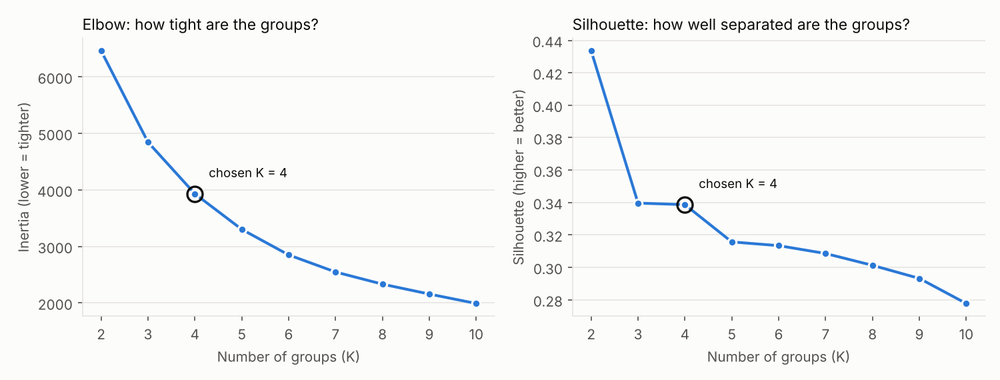

# Customer Behaviour Analysis: RFM + K-Means Segmentation

A personal portfolio project that groups online-retail customers into segments based on how they buy, so a business could target each group differently.

**Tools:** Python, pandas, NumPy, scikit-learn, Matplotlib

## The problem
Sending the same offer to every customer wastes money. Which customers are the most valuable, which are slipping away, and which could be grown?

## Data
[UCI Online Retail dataset](https://archive.ics.uci.edu/dataset/352/online+retail): about 540,000 transaction rows from a UK online gift shop, 1 Dec 2010 to 9 Dec 2011. The raw file is not included in this repo. Download it and save it as `data/Online Retail.xlsx`.

## Approach
1. **Cleaning:** removed rows with no CustomerID, exact duplicates, cancellations *and the original orders they reversed*, non-product rows (postage, manual adjustments, bank fees) and rows with zero or negative quantity or price. 541,909 rows became 388,168 (4,322 customers).
2. **EDA:** monthly revenue (peak in Sep-Nov), revenue by country (UK is 82%), top products, and the spend distribution (heavily right-skewed).
3. **RFM features** per customer: Recency (days since last order), Frequency (number of orders), Monetary (total spend).
4. **Preprocessing:** `log1p` transform to reduce skew (Monetary skewness 21.4 to 0.4), then `StandardScaler`.
5. **K-Means** with K chosen using the elbow method and silhouette score.
6. **Interpretation:** named each cluster from its median R, F and M values.

## Results
K = 4 (silhouette 0.34). K = 2 scored highest but only separated "active" from "gone"; K = 3 and 4 scored almost the same, and K = 4 gave four actionable segments.

| Segment | Customers | Median recency | Median orders | Median spend | Share of revenue |
|---|---|---|---|---|---|
| Champions | 682 (16%) | 8 days | 10 | 3,696 | 64% |
| Loyal Regulars | 1,189 (28%) | 53 days | 4 | 1,327 | 24% |
| Recent Newcomers | 813 (19%) | 16 days | 2 | 471 | 5% |
| Lapsed | 1,638 (38%) | 173 days | 1 | 290 | 7% |

**Key finding:** Champions are 16% of customers but 64% of revenue. Suggested actions: VIP retention for Champions, bundles for Loyal Regulars, a welcome offer for Recent Newcomers and a low-cost win-back campaign for Lapsed customers.




## Limitations
- One year of data, so seasonality and growth cannot be separated.
- No sharp elbow and a moderate silhouette score; segments overlap at the edges and K was chosen partly on business usefulness.
- Cancellations are matched to purchases by exact customer, product, price and quantity; partial returns are not modelled.
- Segment names are my interpretation of the cluster statistics.

## How to run
```bash
pip install -r requirements.txt
# put "Online Retail.xlsx" in the data/ folder, then:
jupyter notebook customer_behavior_analysis.ipynb
```

## Possible next steps
Add features such as basket size and product categories, compare with hierarchical clustering or Gaussian mixtures, and A/B test the campaigns per segment.

## Files
- `customer_behavior_analysis.ipynb`: the full analysis, with explanations
- `data/customer_segments.csv`: every customer with their RFM values and segment
- `charts/`: charts used above
